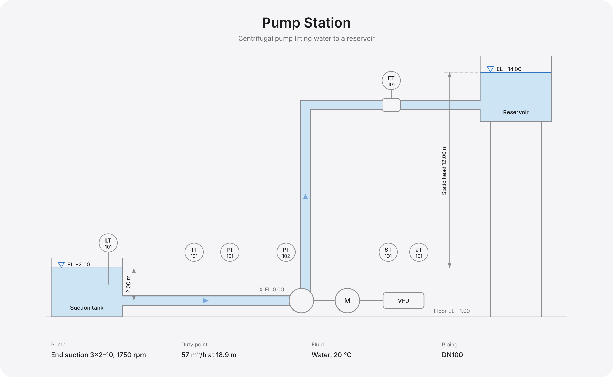
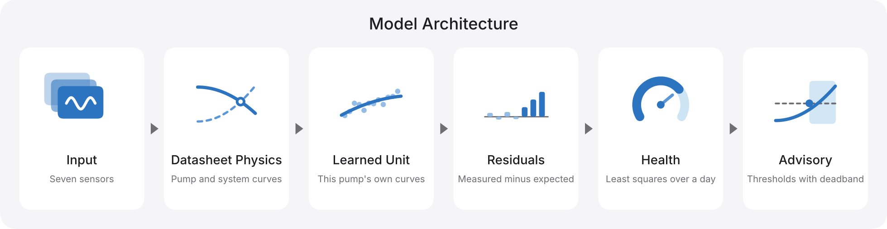
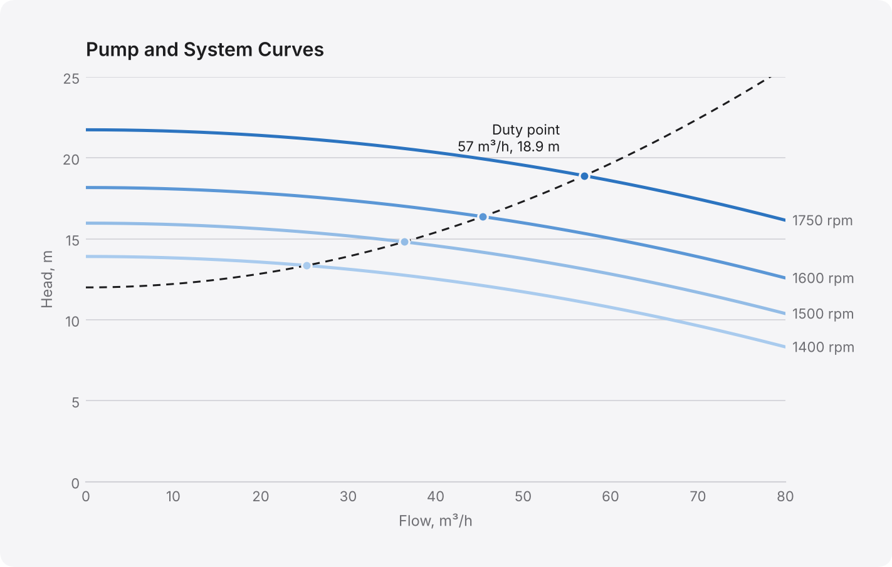
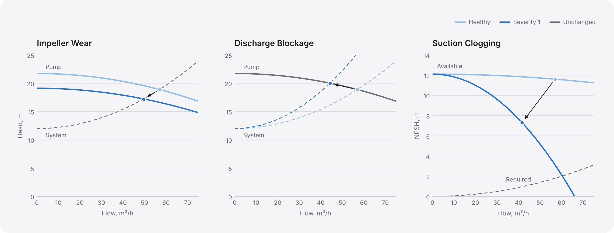
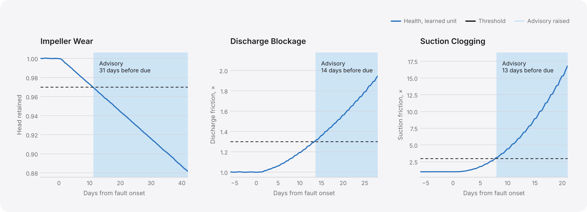
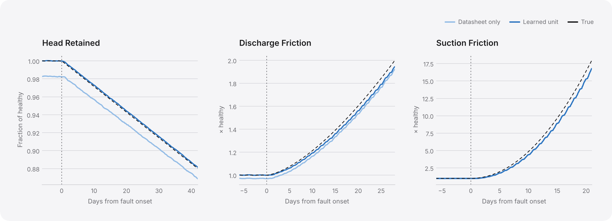
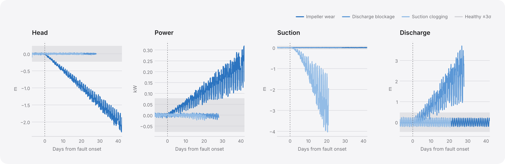

# Pump Performance Diagnosis

<picture>
  <source media="(prefers-color-scheme: dark)" srcset="docs/model-dark.png">
  
</picture>

Pump Performance Diagnosis watches a variable-speed centrifugal pump through the seven instruments a pump station already has, and says how far the pump has drifted from its healthy curves and why. It reports health in engineering units (head lost, pipe friction gained, cavitation margin left) and raises one of three maintenance advisories: impeller wear, discharge blockage or suction clogging. The model is the pump's datasheet physics, corrected by a small learned model of how this particular unit differs from its datasheet. On a simulated station it raises the right advisory 13 to 31 days before each fault is due for maintenance, with no false advisories over nearly two healthy months, and runs in 0.02 ms per minute of readings on one CPU thread.

## The Station

<p>
<picture>
  <source media="(prefers-color-scheme: dark)" srcset="docs/plant-dark.png">
  
</picture>
<br>
<sub><b>Pump station.</b> Elevation view from the suction tank to the reservoir, drawn to scale from the pump centreline. The reservoir surface stands 12 m above the suction tank's, and the suction tank's 2 m above the pump. Instruments carry their ISA-5.1 tags, and dashed lines are signals from the drive.</sub>
</p>

An end-suction 3×2–10 pump at 1750 rpm lifts water from a suction tank to an elevated reservoir. Its best efficiency point (BEP) is 57 m³/h at 18.9 m and 68%. A variable-frequency drive sets its speed through the day.

| Tag | Measures | Used for |
| :-- | :-- | :-- |
| LT 101 | Suction tank level | Suction head |
| TT 101 | Water temperature | Vapour pressure, for the cavitation margin |
| PT 101, PT 102 | Suction and discharge pressure | Pump head, and the losses on each side |
| FT 101 | Flow | Where the pump sits on its curves |
| ST 101, JT 101 | Speed and electrical power, from the drive | Affinity scaling and efficiency |

## How It Works

<picture>
  <source media="(prefers-color-scheme: dark)" srcset="docs/architecture-dark.png">
  
</picture>

**Input.** One reading per minute from each of the seven instruments.

**Datasheet physics.** The pump and its pipes as first principles describe them, with the constants a pump datasheet gives. From measured flow and speed it predicts the head, power and pressures a healthy station should read at that moment.

**Learned unit.** A real pump sits a few percent off its catalogue curve, and its flowmeter carries a small calibration error. A small model, fitted on the station's healthy commissioning month, learns this unit's gap from its datasheet and corrects every prediction.

**Residuals.** Measured minus expected, four of them, each watching one part of the station: head for the impeller, power for the impeller and drive, suction pressure for the suction line and strainer, discharge pressure for the discharge line and valves.

**Health.** Each fault changes one physical parameter, and each residual is linear in that change, so least squares over the last day solves for the parameter directly. Fitting over a full day averages out the daily cycle of speed and reservoir level.

**Advisory.** One rule per fault, with a threshold in engineering units, a six-hour on-delay and a deadband, so a single bad hour cannot raise an advisory and a value hovering at its threshold cannot make one flicker.

The physics, the learned unit and the residuals run as one ONNX graph, `models/pump.onnx`. The day-long sums and the advisory rules are a few lines of state in the host loop, `src/monitoring/monitor.py`.

## The Physics

Everything follows from conservation of energy, similitude and the pump's datasheet.

**System curve.** The energy equation between the two free surfaces, both at atmospheric pressure and with negligible velocity, leaves the lift and the pipe losses. Darcy–Weisbach losses in fully turbulent flow grow with flow squared.

$$H_{sys}(Q) = (z_r - z_s) + (K_s + K_d)\,Q^2$$

with $z_r - z_s = 12$ m of static head, and $K_s$, $K_d$ the suction and discharge line resistances, sized so the duty point sits at the BEP at rated speed.

**Pump curve at any speed.** Similitude keeps the head coefficient $\psi = gH/\omega^2D^2$ a function of the flow coefficient $\phi = Q/\omega D^3$ alone, which gives the affinity laws $Q \propto n$, $H \propto n^2$, $P \propto n^3$. A parabola through shut-off head and the BEP, scaled by them, is

$$H_p(Q, n) = \psi_0 H_b \left(\frac{n}{n_r}\right)^2 - \frac{(\psi_0 - 1)\,H_b}{Q_b^2}\,Q^2$$

with $\psi_0 = 1.15$ the shut-off ratio.

**Efficiency and power.** With $x = Q / (Q_b\, n/n_r)$ the flow relative to the BEP at this speed,

$$\eta = \eta_b\,(2x - x^2), \qquad P_e = \frac{\rho g Q H}{\eta\,\eta_{drive}}$$

**Operating point.** Where the two curves meet. Both are parabolas in flow, so for the datasheet pump

$$Q^* = \sqrt{\frac{\psi_0 H_b (n/n_r)^2 - (z_r - z_s)}{K_s + K_d + (\psi_0 - 1) H_b / Q_b^2}}$$

and a few Newton steps from there handle a real unit's curve. Below about 1310 rpm the pump cannot lift the static head at all.

**Cavitation margin.** The suction head available above vapour pressure, against what the pump needs:

$$NPSH_a = \frac{p_{atm} + p_s - p_v(T)}{\rho g} + \frac{V_s^2}{2g}, \qquad NPSH_r = NPSH_{r,b} \left(\frac{n}{n_r}\right)^2 x^2$$

with $p_v(T)$ from the Antoine equation.

**Measured head.** Both pressure taps are on DN100 pipe at the pump centreline, so the velocity heads cancel and $H_m = (p_d - p_s)/\rho g$.

<p>
<picture>
  <source media="(prefers-color-scheme: dark)" srcset="reports/figures/curves-dark.png">
  
</picture>
<br>
<sub><b>Pump and system curves.</b> Pump curves at 1400, 1500, 1600 and 1750 rpm against the system curve. At 1750 rpm they cross at the BEP, 57 m³/h and 18.9 m. As the drive slows, the duty point slides down the system curve towards the 12 m static head, where efficiency falls from 68% to 55% at 1400 rpm.</sub>
</p>

## The Faults

Each fault is a change to one parameter of these equations, never a new equation. Severity runs from 0, healthy, to 1, due for maintenance.

| Fault | What happens | Parameter | At severity 1 |
| :-- | :-- | :-- | :-- |
| Impeller wear | Worn wear rings leak flow back to suction | BEP head and efficiency | Head −12%, efficiency −12 points |
| Discharge blockage | Fouled pipe or a valve left partly shut | $K_d$ | Doubles |
| Suction clogging | Debris fills the suction strainer | $K_s$ | ×18 |

<p>
<picture>
  <source media="(prefers-color-scheme: dark)" srcset="reports/figures/faults-dark.png">
  
</picture>
<br>
<sub><b>Fault signatures.</b> How each fault at severity 1 moves the pump at 1750 rpm. Wear lowers the pump curve and the duty point slides down the unchanged system curve. Blockage steepens the system curve and the duty point climbs the unchanged pump curve, so head rises while flow falls. Clogging leaves both curves almost in place but collapses the suction head available, from 11.6 m to 7.3 m at the duty point. All three cut flow, so flow alone cannot tell them apart.</sub>
</p>

## Where It Fits

The model is designed for a variable-speed pump in a fixed pipe system, instrumented as most pump stations are, whose condition drifts over weeks.

| The situation | The design |
| :-- | :-- |
| The maker publishes the pump's curves, and the pipes follow known physics | Only the unit's gap from its datasheet is learned, from one healthy month |
| Speed changes through the day with demand | Expectations are taken at the measured flow and speed, so normal operation cancels out |
| A real pump is a few percent off its catalogue, and flowmeters carry calibration error | The learned unit absorbs both, with the same affinity structure as the physics |
| Wear, fouling and clogging develop over weeks | Health is fitted over a day, and advisories wait six hours |
| Maintenance is planned by engineers | Health is reported in their units, and each advisory names its cause |
| The station controller has a modest CPU | One minute of readings takes 0.02 ms |

Some situations call for a different design. Faults that develop in seconds, such as a seized bearing or a dry run, need fast protection, not trend diagnosis. Mechanical faults with little hydraulic effect, such as misalignment or bearing wear, show first in vibration. A station without flow measurement cannot place the pump on its curves.

## How It Performs

The station is simulated minute by minute. Speed follows demand, 1600 to 1750 rpm by day and 1450 to 1560 rpm by night with a new setpoint every two hours, the water warms and cools through the day, and both tank levels drift. The simulated pump is 2.5% below its datasheet head, more at high flow, 1.5 points below its datasheet efficiency, and its flowmeter reads 1.5% high. The model never sees these numbers. Each fault run starts with seven healthy days, then grows its fault to severity 1 over three to six weeks. A second healthy unit-month, never used for fitting, counts false advisories.

| Fault | Advisory raised | True health at the advisory | Datasheet physics alone |
| :-- | :-- | :-- | :-- |
| Impeller wear | 31 days before due | Head 0.968 (threshold 0.97) | Head 0.985, 6 days early |
| Discharge blockage | 14 days before due | Friction 1.34× (threshold 1.3×) | Friction 1.37× |
| Suction clogging | 13 days before due | Friction 3.4× (threshold 3×) | Friction 3.5× |
| Healthy, 1.9 months | 0 false advisories | | 0 false advisories |

Only the right rule fired in each run.

<p>
<picture>
  <source media="(prefers-color-scheme: dark)" srcset="reports/figures/advisories-dark.png">
  
</picture>
<br>
<sub><b>Advisories.</b> The health parameter behind each rule through its fault run, the rule's threshold (dashed) and the period with the advisory raised (shaded). Each advisory comes within hours of the parameter crossing its threshold, 31, 14 and 13 days before the fault reaches maintenance severity.</sub>
</p>

<p>
<picture>
  <source media="(prefers-color-scheme: dark)" srcset="reports/figures/health-dark.png">
  
</picture>
<br>
<sub><b>Health against the truth.</b> Each fault's health parameter estimated with datasheet physics alone and with the learned unit, against its true value (dashed). With the datasheet alone, the healthy pump already reads 1.7% worn, so the wear advisory comes when the impeller has lost half the head the threshold intends. The learned unit reads 1.000 on the healthy pump, follows head retained to within 0.2%, and the two frictions to within a few percent.</sub>
</p>

The learned unit matters for when advice arrives, more than for whether it arrives. Pump acceptance standards allow a new pump a few percent of head deviation from its curve. A diagnosis that trusts the datasheet would call such a pump worn on its first day, or need thresholds so loose that real wear goes unseen.

## How It Was Built

**Residuals before health.** Comparing each reading with its healthy expectation at the measured flow and speed makes normal operation cancel out. Each fault then moves one residual and leaves the others flat, so the three causes separate without a classifier.

<p>
<picture>
  <source media="(prefers-color-scheme: dark)" srcset="reports/figures/residuals-dark.png">
  
</picture>
<br>
<sub><b>Residuals.</b> Hourly means of the four residuals through the three fault runs, against the healthy ±3σ band. Wear lowers head and raises power, blockage raises discharge pressure and clogging lowers suction pressure. The pipe residuals ripple daily, because a pipe loss grows with flow squared and flow follows demand.</sub>
</p>

**From residuals to health.** A residual is not yet a health number: the same blockage gives a large discharge residual at full daytime flow and a small one at night. Each residual is linear in its fault's parameter, for example $r_d = \Delta K_d\,Q^2$, so the parameter is the least-squares fit over a window,

$$\hat{K}_d = K_d + \frac{\sum r_d\,Q^2}{\sum Q^4}$$

which weights each minute by how much it says. A day-long window spans the whole daily cycle, and the ripple disappears. The cavitation margin is a present danger rather than a trend, so it is averaged over the last hour only.

**The learned unit, given the physics' structure.** The first correction was a free polynomial in flow and speed, fitted on the healthy month. It failed once a fault moved the pump to low flows the healthy month never reached: it extrapolated wildly and hid two-thirds of a blockage. The correction now has the same structure as the physics, so it extrapolates as the pump does:

| Residual | Learned gap | From |
| :-- | :-- | :-- |
| Head | $(n/n_r)^2\, p(x)$ | Affinity law for head |
| Power | $(n/n_r)^3\, p(x)$ | Affinity law for power |
| Suction, discharge | $a + b\,Q^2$ | A pipe depends on flow alone |

It is fitted by least squares on 21 healthy days, and the degree of $p$ is chosen on the 7 held out, the smallest that cuts validation error by more than 2%. Degree 1 won, so the learned unit is 8 coefficients.

**A fault renamed by the physics.** The third fault started as suction starvation leading to cavitation. The numbers said otherwise: with the tank 2 m above the pump, a clogging strainer also throttles the flow, which protects the pump, and the margin never falls below 7 m. It is modelled as what it is, a clogging strainer, and the cavitation margin is reported as a health number with its own rule.

**Thresholds as maintenance criteria.** Each threshold says when the work is worth doing (3% head lost, 30% more line friction, a strainer loss tripled, 3 m of cavitation margin), not how many standard deviations a value has moved.

**An ONNX graph without a framework.** Every operation in the per-minute path is arithmetic, so the graph is written directly in ONNX operators through a small expression builder, `src/deployment/export.py`, which reads like the equations above. It matches the Python pipeline to 8 × 10⁻⁶ on the residuals and 7 × 10⁻⁷ on health.

## How to Use It

The model is released in `models/` as `pump.onnx` (4.9 KB), with the learned unit in `correction.json` and the healthy baseline in `baseline.json`. Running it needs NumPy and ONNX Runtime.

### Installation

```bash
git clone https://github.com/iamabdirazak/pump-performance-diagnosis.git
cd pump-performance-diagnosis
python3 -m venv .venv && source .venv/bin/activate
pip install -r requirements.txt
python -m pytest -q
```

### Monitoring a Pump

```python
from src.monitoring.monitor import Monitor

monitor = Monitor()                     # loads models/pump.onnx

while running:                          # once a minute
    monitor.step({
        "level": 2.02,                  # m above the pump centreline
        "temperature": 19.4,            # °C
        "suction_pressure": 16.8,       # kPa gauge
        "discharge_pressure": 182.3,    # kPa gauge
        "flow": 51.6,                   # m³/h
        "speed": 1690,                  # rpm
        "power": 4.18,                  # kW
    })
    print(monitor.health)               # after the first day
    print(monitor.advisories)           # updated hourly
```

For another pump, the datasheet constants live in `src/plant/pump.py`, and the learned unit is refitted on the new station's healthy month with `python -m src.models.train`.

### Reproducing the Results

```bash
python -m src.data.simulate             # station histories, into data/
python -m src.models.train              # learned unit and healthy baseline
python -m src.evaluation.score          # advisories, into reports/results.json
python -m src.deployment.export         # models/pump.onnx
python -m src.deployment.verify         # equivalence and latency
for f in curves faults residuals health advisories diagrams; do python -m src.visualization.$f; done
```

Everything runs on a CPU in under a minute.

## Limitations

- Tested in simulation only. The station, its instruments and its faults are modelled from first principles, with representative datasheet values for a 3×2–10 pump.
- Each run holds one fault. Two faults growing together would move two parameters at once, which the least-squares fits separate but the rules have not been tested on.
- The flowmeter's gain error cannot be learned without a reference meter. It enters the friction estimates squared, so suction friction reads about 4% low at its worst.
- The reservoir level is not measured. Its daily swing of ±0.2 m is the largest source of noise in the discharge fit.
- Times are measured on a general-purpose CPU, not on a station controller.

## License

The code is released under the MIT License.

## Author

Abdirazak Mubarak, November 2026
